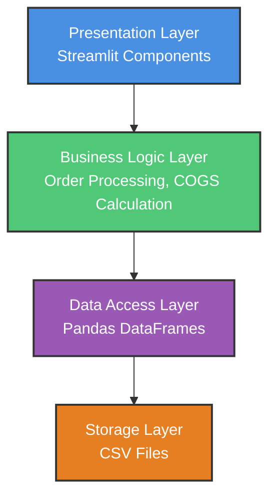

# Theta Coffee Lab ☕

A comprehensive cafe management system with real-time analytics, inventory tracking, and financial reporting.


## Overview

Theta Coffee Lab Management System is a full-stack business intelligence application designed to streamline cafe operations. Built with Python and Streamlit, it provides an intuitive interface for managing sales, inventory, recipes, and financial performance.

## Features

| Feature | Description |
|---------|-------------|
| 📊 **Dashboard** | Real-time KPIs including revenue, orders, gross profit margin, and performance trends |
| 🛒 **Order Management** | Process sales transactions with automatic inventory deduction |
| 📦 **Inventory Control** | Track stock levels with intelligent low-stock alerts based on unit types |
| 🍵 **Recipe Builder** | Create and manage product recipes with automatic COGS calculation |
| 💰 **Financial Analytics** | Comprehensive reports with revenue breakdown, cost analysis, and profitability metrics |
| 🗺️ **Geospatial Analysis** | Visualize customer locations using Google Plus Codes integration |

## Tech Stack

- **Framework**: Streamlit 1.65 (top navigation, native light and dark themes)
- **Data Processing**: Pandas, NumPy
- **Visualization**: Plotly 7 (interactive charts, MapLibre maps)
- **Geolocation**: GeoPy
- **Storage**: CSV-based data persistence

## UI Upgrade (v2)

The interface was rebuilt on Streamlit's native theming instead of hand-written CSS:

- **Top navigation** with Material icons replaces the default sidebar page list, plus a theta logo mark.
- **Two designed themes**, light and dark, in `.streamlit/config.toml`: Geist typography, a single cobalt accent on neutral surfaces, rounded cards, and pill buttons. The app follows the viewer's system setting; the ⋮ menu switches it.
- **One chart style everywhere**: `utils.chart()` puts every Plotly figure in a bordered card with thin marks and rounded bar ends. Six copy-pasted ggplot templates are gone, and chart colors come from a colorblind-checked categorical palette.
- **Better chart choices**: pies with 10+ slices became sorted bar charts, single-series bars use one color instead of a rainbow, and the financial chart has a unified hover.
- **Dashboard**: seven KPI tiles with icons and daily sparklines in two even rows, a time-period segmented control, a full-width revenue trend, and two same-height rankings side by side.
- **Home**: a hero with an all-time snapshot and a module grid.

It also fixes three things that broke on current library versions:

- **Customer Map**: Plotly 7 removed `scatter_mapbox`, and the old Carto tiles showed "API KEY REQUIRED". The map now uses MapLibre `scatter_map` and centers on the orders.
- **Settings**: "Toggle Theme Now" rewrote `config.toml` at runtime. It is removed; theme switching is built in.
- **Dependencies**: `requirements.txt` now exists, and `pyproject.toml` and `uv.lock` pin Streamlit 1.65 and Plotly 7.

## Architecture



## Project Structure

```
theta-coffee-lab/
├── app.py                 # Navigation, theme setup, and the Home page
├── utils.py               # Shared helpers: currency, dates, KPIs, chart styling
├── data_init.py           # Data initialization module
├── requirements.txt
├── .streamlit/config.toml # Light and dark themes
├── assets/logo.svg
├── tests/test_pages.py    # Smoke test: every page renders without errors
├── pages/
│   ├── 1_dashboard.py     # Analytics dashboard
│   ├── 2_order.py         # Order management
│   ├── 3_inventory.py     # Inventory tracking
│   ├── 4_product.py       # Recipe management
│   ├── 5_financial.py     # Financial reports
│   ├── 6_map.py           # Customer location map
│   └── 7_settings.py      # Application settings
└── data/
    ├── sales.csv
    ├── inventory.csv
    ├── products.csv
    ├── product_recipe.csv
    ├── inventory_transactions.csv
    └── operational_costs.csv
```

## Installation

```bash
# Clone the repository
git clone https://github.com/johnha912/theta-coffee-lab.git
cd theta-coffee-lab

# Install dependencies
pip install -r requirements.txt

# Run the application (opens on port 5000, set in .streamlit/config.toml)
streamlit run app.py

# Optional: check that every page renders against the bundled data
python tests/test_pages.py
```

## Key Technical Highlights

- **Reactive UI**: Leverages Streamlit's reactive paradigm for real-time updates
- **Intelligent Alerting**: Dynamic inventory thresholds based on unit types (ml, g, pcs)
- **Automatic COGS Calculation**: Recipe-based cost computation for accurate profit margins
- **Data Visualization**: Interactive Plotly charts with custom ggplot2-inspired theming
- **Session State Management**: Persistent user preferences across page navigation

## Screenshots

> **Note:** For customer privacy and financial security reasons, all figures shown in these screenshots have been modified and are for demonstration purposes only to help users understand how the application works.

### Before and after

The "before" shots run the previous release on its locked versions (Streamlit 1.44, Plotly 6). Both sides use the same data and the "All Time" period.

| | Before | After |
|---|---|---|
| **Home** |  |  |
| **Dashboard** |  |  |
| **Financial** |  |  |
| **Map** |  |  |

### Light theme

| Home | Dashboard | Financial |
|---|---|---|
|  |  |  |

### Other pages

| Order | Inventory |
|---|---|
|  |  |
| **Product** | **Settings** |
|  |  |

## Future Enhancements

- [ ] PostgreSQL database integration for production scalability
- [ ] User authentication and role-based access control
- [ ] REST API endpoints for mobile app integration
- [ ] Automated report generation and email scheduling

## License

This project is licensed under the MIT License - see the [LICENSE](LICENSE) file for details.
